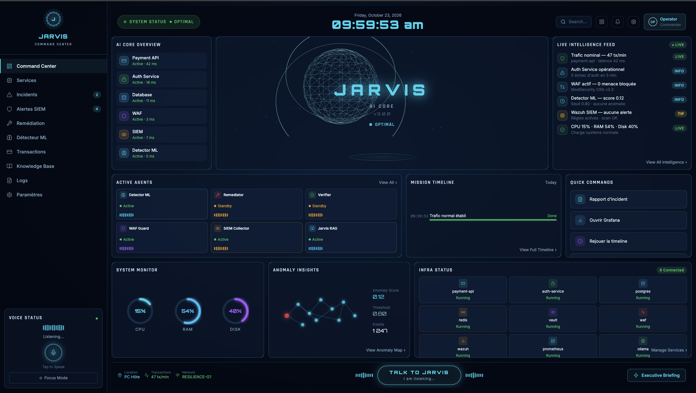
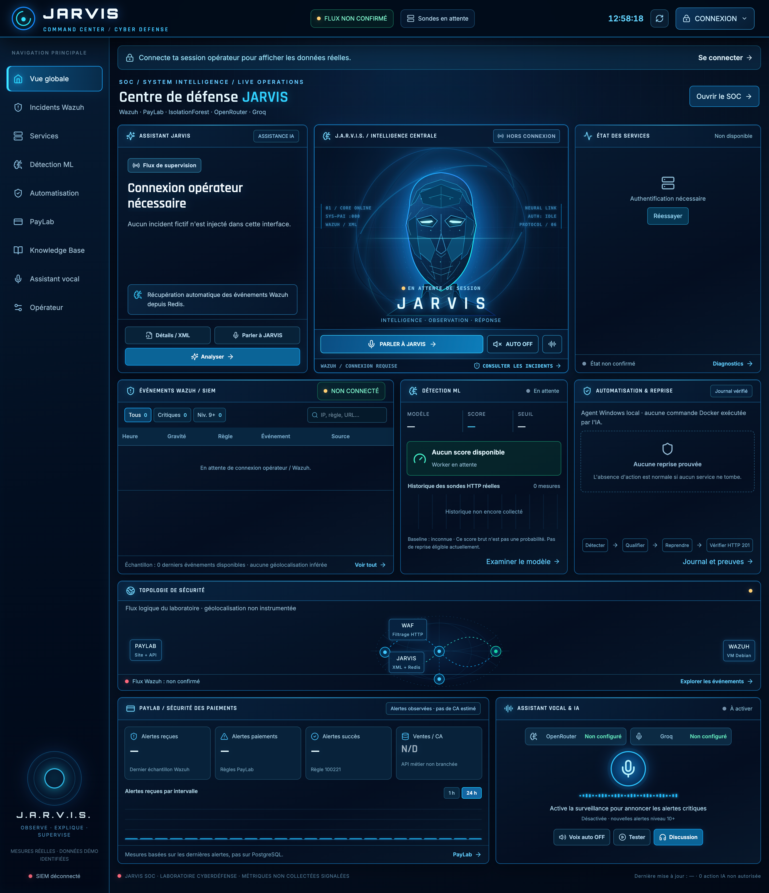
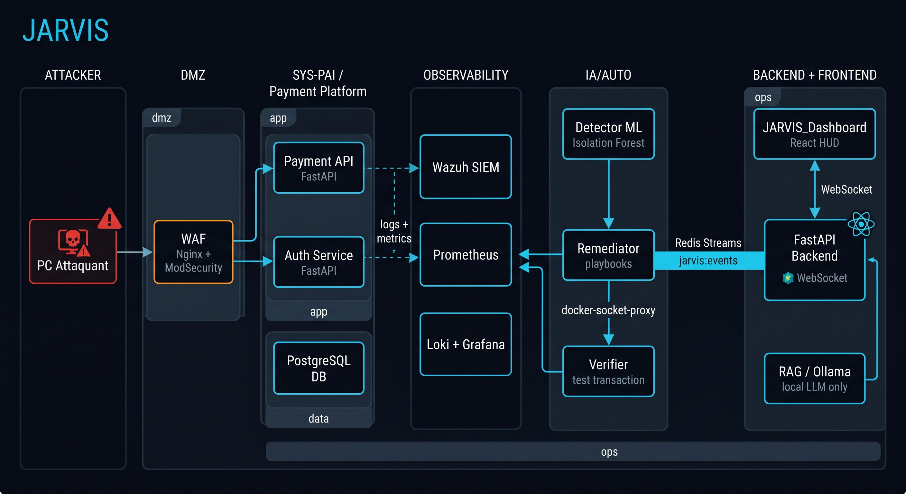

# JARVIS — Autonomous Cyber Defense Platform

> **Workshop M2 2026 · PROJECT RESILIENCE-ALPHA**  
> A payment platform that detects real attacks with machine learning, restores itself without human intervention, and confirms recovery with a live transaction, all shown on a HUD in real time.

---

## What it does

A financial platform gets attacked. JARVIS detects it before any human does, restores the service on its own, then runs a real payment to confirm everything works. The whole loop (detection, decision, remediation, proof) takes under 60 seconds. The attack comes from a separate machine, the ML model reads live Wazuh alerts, and the recovery agent is a standalone process with a signed audit trail of every action it took.

---

## Dashboard

### Command Center (our interface)



The main HUD displays system state in real time: the 3D wireframe orb turns red during an attack and green once recovery is confirmed. Every panel (agents, timeline, ML score, infra status) updates live via WebSocket.

### SOC Operations View



The operator panel gives authenticated access to live service probes, Wazuh alert logs, the ML detector output, and the recovery audit journal. JARVIS has no write access to the remediation engine; it only reads and explains.

---

## Quick start

```bash
cp .env.example .env     # fill in secrets
make build               # build all Docker images
make up                  # start the full stack
```

| URL | What's there |
|---|---|
| `http://localhost:5173` | JARVIS dashboard |
| `http://localhost:3001` | Grafana (metrics + logs) |
| `http://localhost:9090` | Prometheus |

---

## Architecture



## How the autonomous loop works

```
PC Attaquant ──► WAF (Nginx + ModSecurity)
                     │
              Payment API / Auth / DB
                     │ logs + metrics
              Wazuh SIEM + Prometheus + Loki
                     │ jarvis:wazuh:recent (Redis)
              Detector ML (Isolation Forest, 8 features)
                     │ jarvis:events stream
              Remediator (playbooks via docker-socket-proxy)
                     │
              Verifier (real test transaction)
                     │
        Frontend JARVIS ◄── Backend WebSocket
```

The loop has four steps:

1. **Detect:** The ML worker reads Wazuh alert windows every 5 seconds. When the anomaly score crosses the learned threshold and a service is actually down, it raises an `eligible_for_recovery` flag.
2. **Decide:** The Windows recovery agent polls that flag, checks the Docker container state before touching anything, and applies a 180-second cooldown between actions.
3. **Remediate:** `docker start jarvis-auth-service`. The allowed container list is hardcoded to two names.
4. **Verify:** A fresh user account is registered and a `€1.00` payment is processed through the WAF. HTTP 201 = recovered. The result lands in `recovery-audit.jsonl` and the dashboard.

---

## Stack

| Layer | Technology |
|---|---|
| Frontend | React 18 + Vite + TypeScript + Tailwind CSS + Three.js (orb) |
| Backend | FastAPI + WebSocket + Redis Streams |
| Payment system | FastAPI + PostgreSQL (our own, no Stripe) |
| ML detection | scikit-learn Isolation Forest — 8 Wazuh-based features |
| LLM / RAG | Ollama (qwen2.5:3b Q4) + LangChain + TF-IDF — fully local |
| Observability | Prometheus + Loki + Promtail + Grafana |
| Security | Nginx + ModSecurity CRS (WAF) + Wazuh SIEM + HashiCorp Vault |
| Infra | Docker Compose + Ansible + docker-socket-proxy |

---

## Project structure

```
jarvis/
├── frontend/          React HUD dashboard
├── backend/           FastAPI — WebSocket relay, Wazuh API, RAG proxy
├── sys-pai/           Payment API + Auth service + PostgreSQL (attack target)
├── siem/              WAF config, Wazuh rules, Prometheus, Loki, Grafana
├── ia-auto/
│   ├── detector/      IsolationForest worker — reads Wazuh, writes ML score to Redis
│   ├── remediator/    Playbook engine — consumes anomaly events, acts via socket proxy
│   └── verifier/      Post-remediation transaction probe
├── workshop/
│   ├── ml/            Standalone ML worker + model (host-side)
│   ├── rag/           Local RAG server (TF-IDF + Ollama, port 8120)
│   └── recovery_agent.py   Windows recovery agent with audit trail
├── infra/             Ansible playbooks + Vault policies
├── attacks/           Red team scripts (flood, brute force, SQLi, chaos)
└── docs/              PCA/PRA, EBIOS RM, runbooks (also used as RAG knowledge base)
```

---

## Make targets

| Command | What it does |
|---|---|
| `make up` | Start the full stack |
| `make down` | Stop everything |
| `make logs` | Stream all service logs |
| `make demo` | Run the automated attack + recovery scenario |
| `make attack` | Launch a flood from localhost (dev only) |
| `make reset` | Wipe volumes and start fresh |

---

## ML model

The detector uses an **Isolation Forest** trained on 8-dimensional feature windows extracted from Wazuh alerts:

| Feature | What it measures |
|---|---|
| `events` | Total alerts in the last 60 seconds |
| `auth_failed` | Authentication failure rules (100210, 100211, 100223, 100224) |
| `payments_declined` | Payment rejection rules (100220, 100225, 100226) |
| `blocked` | HTTP 403/429 responses |
| `probes` | Reconnaissance patterns (100212–100217, 31101) |
| `critical` | Alerts at Wazuh level ≥ 12 |
| `unique_ips` | Distinct source IPs in the window |
| `service_down` | Number of services failing their `/health` probe |

Training runs on a simulated normal baseline until approved real samples are collected. The model comes pre-trained; no training step is needed before the demo.

```bash
# Force retrain on approved baseline
docker compose exec detector python train.py
```

---

## Recovery agent

Run on the host before the demo (not inside any container):

```bash
# Dry run — logs what would happen, touches nothing
python workshop/recovery_agent.py

# Live — authorizes the allowlisted docker start
python workshop/recovery_agent.py --execute
```

The agent writes every decision to `workshop/recovery-audit.jsonl`. The proof entry looks like this:

```json
{"event_time": "2026-10-22T18:40:22Z", "state": "considered", "service": "jarvis-auth-service", ...}
{"event_time": "2026-10-22T18:40:22Z", "state": "restarted", "service": "jarvis-auth-service", ...}
{"event_time": "2026-10-22T18:40:24Z", "state": "verified",  "service": "jarvis-auth-service", "payment_http": 201}
```

---

## Security constraints

- No human intervention during the demo; there is no "repair" button
- LLM stays local: Ollama only, model ≤ 8B parameters
- JARVIS is read-only; it has no write access to Docker, the DB, or the remediator
- No secrets in the repo; everything goes through `.env` (gitignored) and Vault
- The remediator goes through `docker-socket-proxy` rather than touching `/var/run/docker.sock` directly
- The recovery agent's container allowlist is hardcoded to two names: `jarvis-auth-service` and `jarvis-waf`

---

## Operator access

Set `JARVIS_OPERATOR_TOKEN` (≥ 8 chars) in `.env`. Optionally add `JARVIS_MFA_SECRET` (base32, ≥ 16 chars) to enable TOTP two-factor login via `POST /operator/session`.

```bash
JARVIS_OPERATOR_TOKEN=your-token-here
JARVIS_MFA_SECRET=BASE32SECRETHERE   # optional, enables MFA
JARVIS_RECOVERY_TOKEN=32-char-secret-for-recovery-agent
```

---

*Workshop M2 2026 · PROJECT RESILIENCE-ALPHA*
